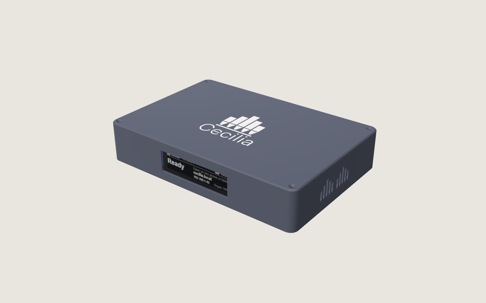
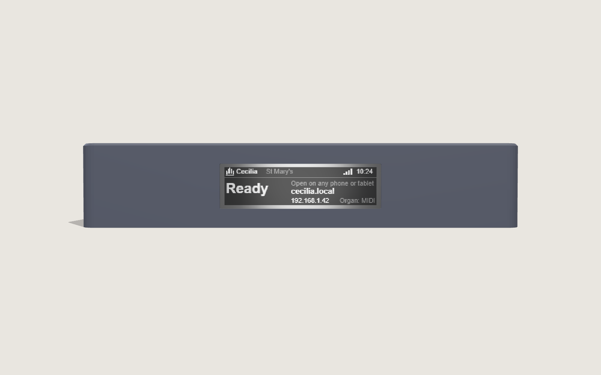
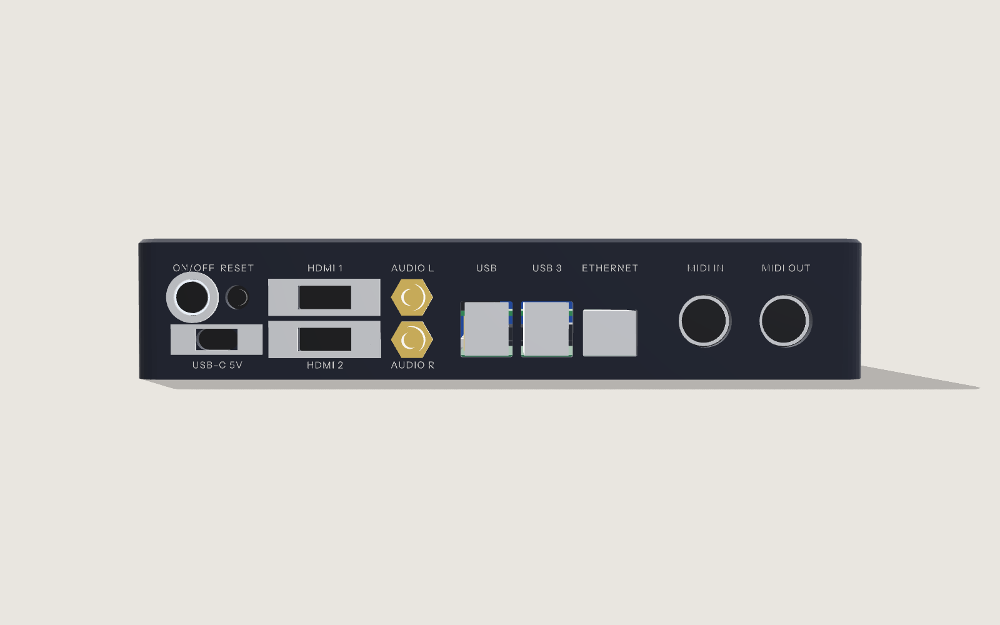
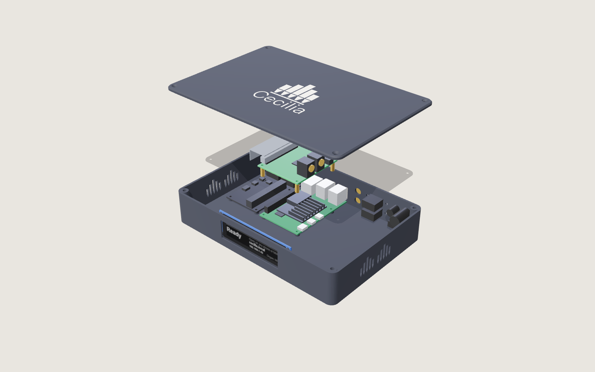
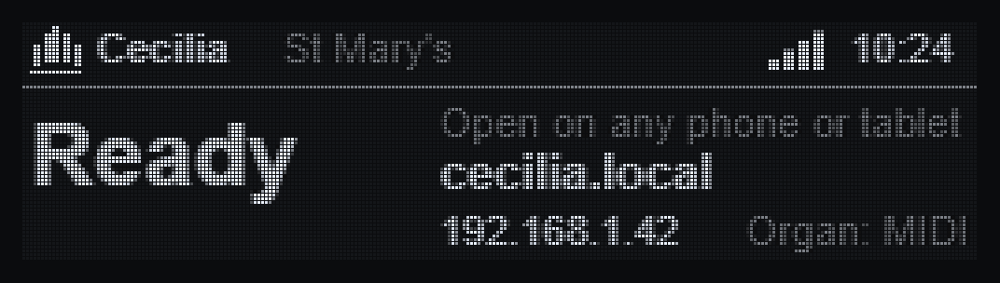
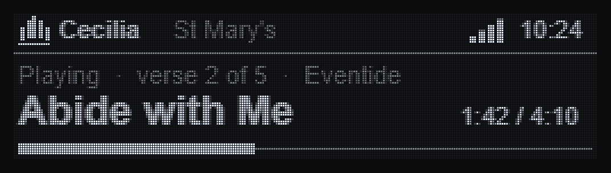
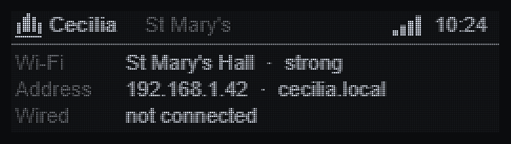
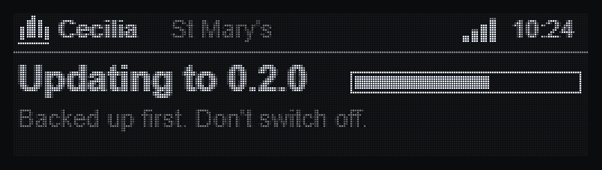

# Cecilia hardware

An all-in-one Cecilia unit. Plug it into the organ, the church network, the
console's touch screens and the power, and Cecilia is ready on every phone and
tablet in the building.

It is a flat box holding a standard **Raspberry Pi 5** and the small
**Cecilia I/O board**, which adds the MIDI sockets. There's room for an
optional **Raspberry Pi DAC+**, so a church with no organ can plug it straight
into its sound system. The Pi keeps its own approvals, Wi-Fi included, and
anything that fails can be swapped with a screwdriver.

| | |
| --- | --- |
| Computer | Raspberry Pi 5 (4 GB), any from any shop |
| Organ | MIDI IN and MIDI OUT (5-pin DIN), or USB for organs with a USB port |
| Screens | Two touch screens: HDMI 1 and HDMI 2 (full size), touch over USB |
| USB | Four sockets: organ, two touch screens, one spare |
| Network | Wi-Fi (the Pi's own, through the plastic case) and Gigabit Ethernet |
| Sound | Optional Raspberry Pi DAC+: AUDIO L and R (phono) to the church sound system |
| Display | 3.12-inch 256 × 64 OLED: ready, address, what's playing, updates |
| Controls | ON/OFF (lit ring) and RESET |
| Power | USB-C, Raspberry Pi 27 W supply |
| Size | 220 × 150 × 42 mm |
| Cost | About US$310 in parts for a prototype; about US$200 at volume ([docs/COST.md](docs/COST.md)) |

Only the display is on the front:

Everything else is on the back:

Lift the lid (four screws) and every part is standard. The DAC+ is shown
fitted:

## The display

## In this repository

| | |
| --- | --- |
| [docs/SPEC.md](docs/SPEC.md) | The unit and the I/O board: block diagram, pins, MIDI, audio, display, controls, repairs, certification |
| [docs/COST.md](docs/COST.md) | What a unit costs: prototypes, small batches, volume, and one-off costs |
| [docs/PCBWAY-ORDER.md](docs/PCBWAY-ORDER.md) | What to order from PCBWay, and the options to choose |
| [bom/io-bom.csv](bom/io-bom.csv) | Bill of materials for the I/O board, in PCBWay's layout |
| [bom/off-board.csv](bom/off-board.csv) | Everything else in the box: Pi 5, supply, display, DAC+, panel cables, screws |
| [case/](case/) | The case as code: `npm install`, `npm run build` (STL files), `npm run render` (pictures) |
| [docs/future/CM5-CARRIER.md](docs/future/CM5-CARRIER.md) | A later option: a Compute Module 5 carrier board instead of the Pi 5 |

## Where it's up to

| | |
| --- | --- |
| Specification | Draft, ready for an electronics designer to review |
| Bill of materials | Draft: parts marked CHECK need confirming; final counts come from the schematic |
| Schematic and layout (KiCad) | Not started: a simple 2-layer board |
| Case | Designed and rendered; the Pi 5's socket positions and the panel parts need measuring before printing |
| Cecilia software | To do: serial MIDI on the Pi's UART, the display service, the RESET button and the ON/OFF light |
| Certification | EMC test of the finished unit before selling (see the spec) |

Until then, Cecilia runs on an ordinary Raspberry Pi 4 or 5 with a USB MIDI
interface: see [cecilia-pi](https://github.com/garethcheyne/cecilia-pi).

## Licence

Hardware design (boards, case, drawings): CERN-OHL-P v2, in
[LICENSE-HARDWARE](LICENSE-HARDWARE). Code (the case scripts): MIT, in
[LICENSE-CODE](LICENSE-CODE). The case uses Instrument Sans (SIL Open Font
License, `case/fonts/OFL.txt`).
