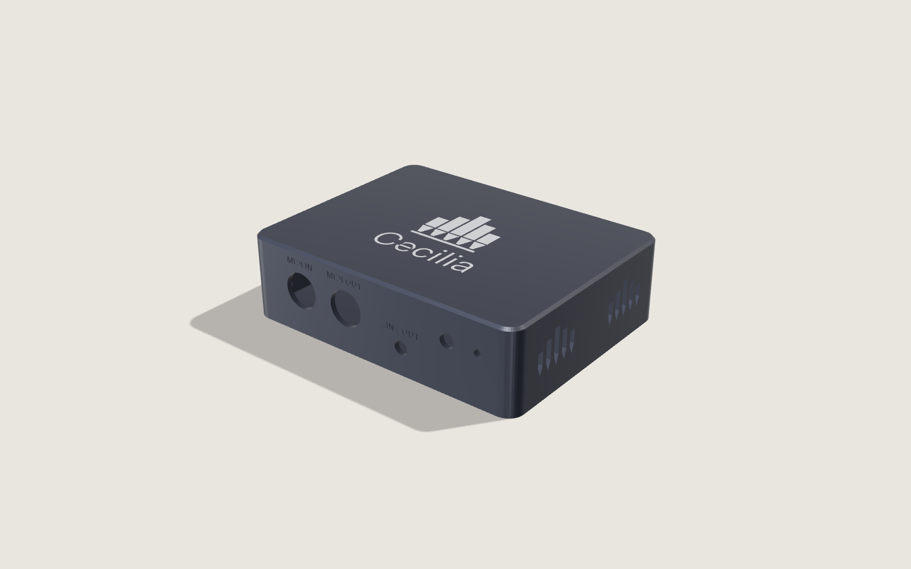
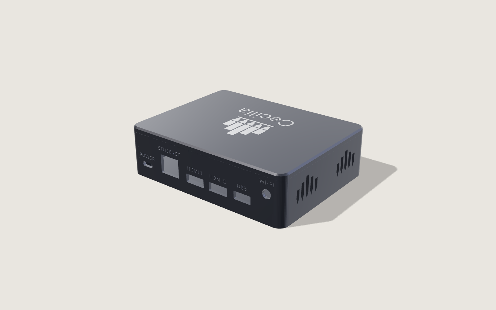

# Cecilia hardware

An all-in-one Cecilia unit: plug it into the organ, the church network and the
power, and Cecilia is ready on every phone and tablet in the building.

| | |
| --- | --- |
| Computer | Raspberry Pi Compute Module 5 (Wi-Fi, 4 GB, 32 GB eMMC: CM5104032) |
| Organ | MIDI IN and MIDI OUT (5-pin DIN), or USB for organs with a USB port |
| Network | Wi-Fi (external antenna) and Gigabit Ethernet |
| Screens | Two HDMI, for the console |
| Sound | 3.5 mm line out |
| Power | USB-C (Raspberry Pi 27 W supply) |
| Size | 132 × 102 × 37 mm |

## In this repository

| | |
| --- | --- |
| [docs/SPEC.md](docs/SPEC.md) | The carrier board: block diagram, power, MIDI circuits, connector layout |
| [docs/PCBWAY-ORDER.md](docs/PCBWAY-ORDER.md) | What to order from PCBWay, and the options to choose |
| [bom/carrier-bom.csv](bom/carrier-bom.csv) | Bill of materials for the carrier board, in PCBWay's layout |
| [bom/off-board.csv](bom/off-board.csv) | Everything else in the box: the CM5, cooler, antenna, battery, screws |
| [case/](case/) | The case as code: `npm install`, `npm run build` (STL files), `npm run render` (pictures) |

## Where it's up to

| | |
| --- | --- |
| Specification | Draft, ready for an electronics designer to review |
| Bill of materials | Draft: parts marked CHECK need confirming, and final counts come from the schematic |
| Schematic and layout (KiCad) | Not started: the next step, based on Raspberry Pi's CM5 IO Board design |
| RP2040 MIDI firmware | Not started (TinyUSB, class-compliant USB MIDI) |
| Case | Designed and rendered; ready for 3D-printed prototypes |
| Certification | Not started (RCM, CE/UKCA, FCC) |

Before then, Cecilia runs on an ordinary Raspberry Pi 4 or 5 with a USB MIDI
interface: see [cecilia-pi](https://github.com/garethcheyne/cecilia-pi).

## Licence

Hardware design: CERN-OHL-P v2. Code: MIT. The case uses Instrument Sans
(SIL Open Font License, `case/fonts/OFL.txt`).
