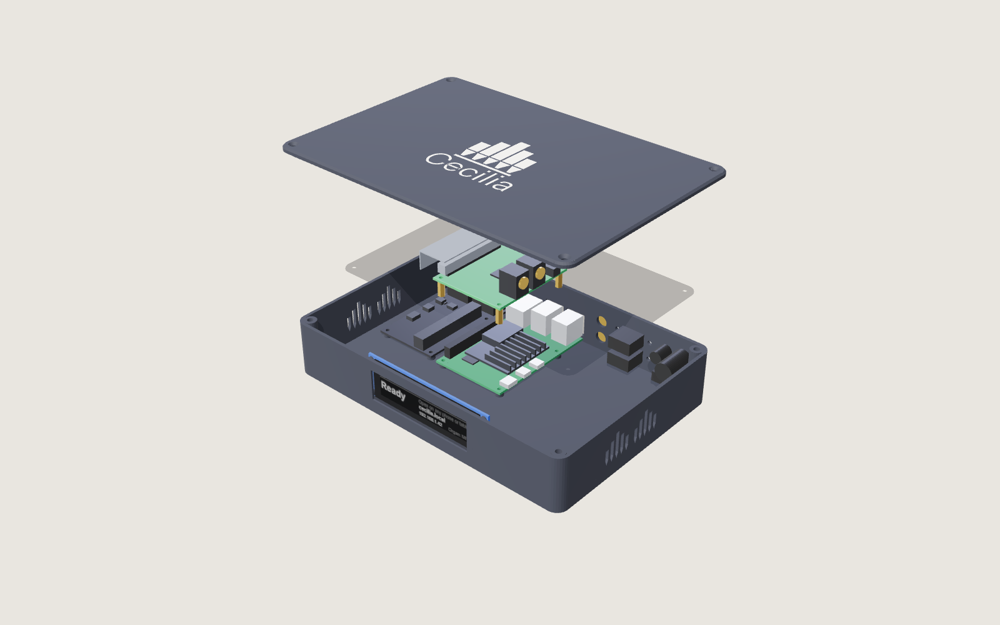
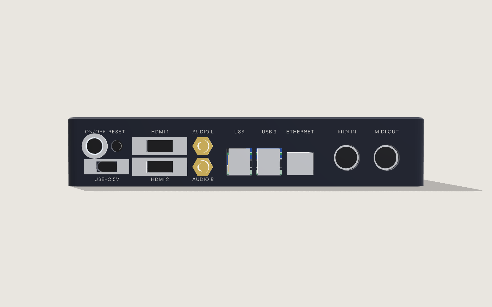

# Cecilia unit: specification

An all-in-one Cecilia box. A standard **Raspberry Pi 5** does the computing.
A small **Cecilia I/O board** adds the organ's MIDI sockets. A wide display
on the front shows what the unit is doing. Everything you plug in is on the
back, and the front has only the display. An optional **Raspberry Pi DAC+**
lets the unit play straight into the church sound system when there is no
organ. All of it goes in a flat plastic box.

This document is the brief for the I/O board's schematic and layout, and for
the case. An electronics designer must review it before anything is ordered.



## Why it's built this way

- **Approvals carry over.** The Pi 5 is already tested and certified, radio
  included, and nothing changes its Wi-Fi or its antenna. The I/O board has
  no radio, no mains and no fast signals, so the product's own EMC testing
  should be short. It still needs that testing before it is sold: see
  [Certification](#certification).
- **Repairable.** Every part is standard and swaps with a screwdriver: the
  Pi, the DAC+, the I/O board, the display, the panel cables and the power
  supply. A failed Pi is replaced by any Pi 5 from any shop, with the same
  card moved across.
- **Room to spare.** The box is bigger than it needs to be, on purpose. Air
  around the Pi keeps it cool, and there's space for the DAC+ and whatever
  comes later.
- **The GPIO header stays free for the DAC+.** The I/O board doesn't sit on
  the header, so it isn't a HAT and has no ID EEPROM. It connects by a
  ribbon to the DAC+'s pass-through header, or straight to the Pi when there
  is no DAC+. Only one board in a stack may carry a HAT EEPROM, and the DAC+
  has one.

## What the unit does

- Runs Cecilia from the Cecilia Raspberry Pi image on a microSD card.
- Connects to the organ by **MIDI IN and MIDI OUT** (5-pin DIN), or by
  **USB** for organs with a USB port.
- Drives **two touch screens** at the console: each takes one HDMI socket
  and one USB socket (for touch). The screens bring their own power.
- Joins the church network by **Wi-Fi** (the Pi's own, through the plastic)
  or **Ethernet**.
- With the **DAC+**, plays to the church sound system through two phono
  sockets (AUDIO L and R): the simulator, or a whole service with no organ.
- Shows its **status, address and what's playing** on the front display.
- Powers from the **Raspberry Pi 27 W USB-C supply**.

## Panels



| Panel | Left to right (seen from that side) |
| --- | --- |
| Front | The display. Nothing else |
| Back | ON/OFF (lit ring) and RESET above USB-C 5V · HDMI 1 above HDMI 2 · AUDIO L above AUDIO R · USB (2 sockets) · USB 3 (2 sockets) · ETHERNET · MIDI IN · MIDI OUT |
| Sides | Vents shaped like organ pipes (and slots in the floor under the Pi) |

Four USB sockets: one for an organ with a USB port, one for each touch
screen's touch connection, and one spare. Any socket works for any of them.

The Pi sits with its USB and Ethernet sockets straight through the back wall.
Its USB-C power and two micro HDMI sockets face sideways, so short
panel-mount cables bring them to full-size sockets on the back. Full-size
HDMI suits touch screens better anyway: standard cables, no fragile micro
plugs.

Panel cut-out positions come from the case model
([case/layout.mjs](../case/layout.mjs)). The Pi's socket positions and the
panel-mount parts' sizes there are marked CHECK. Measure them against the
real parts before ordering a case.

## Block diagram

```
 USB-C 27 W supply ─▶ panel USB-C extension ─▶ Raspberry Pi 5
                                                ├─ USB ×4, Ethernet ─▶ back panel (direct)
                                                ├─ micro HDMI ×2 ─▶ panel HDMI cables ─▶ HDMI 1, HDMI 2
                                                ├─ J2 power-button header ◀─ ON/OFF (through the I/O board)
                                                └─ 40-pin header
                                                     └─ Raspberry Pi DAC+ (optional) ─▶ phono leads ─▶ AUDIO L/R couplers
                                                          └─ pass-through header ─▶ 40-way ribbon ─▶ Cecilia I/O board

 Cecilia I/O board
   GPIO14 (UART0 TX) ─▶ 74LVC1G125 ─▶ 10 Ω / 33 Ω ─▶ MIDI OUT (DIN)
   GPIO15 (UART0 RX) ◀─ H11L1 optocoupler ◀─ 220 Ω ◀─ MIDI IN (DIN)
   SPI0 (GPIO8, 10, 11) + GPIO24 (DC), GPIO25 (RESET) ─▶ 8-wire lead ─▶ display
   GPIO13 (PWM) ─▶ 2N7002 ─▶ ON/OFF light ring
   GPIO26 ◀─ RESET button
   ON/OFF switch ─▶ passed through to the Pi 5's J2 header
```

## Pins used

The DAC+ uses I2S (GPIO18, 19, 20, 21), I2C (GPIO2, 3) and its own ID pins
(GPIO0, 1). The I/O board keeps clear of all of these.

| Pin | Use | Notes |
| --- | --- | --- |
| GPIO14, GPIO15 | UART0: MIDI OUT, MIDI IN | 31 250 baud |
| GPIO8, GPIO10, GPIO11 | SPI0: display chip select, data, clock | |
| GPIO24, GPIO25 | Display data/command, display reset | |
| GPIO13 | ON/OFF light ring | PWM, so it can breathe while starting |
| GPIO26 | RESET button | Internal pull-up; button to ground |

## MIDI (MIDI 1.0 electrical specification, 3.3 V)

- **MIDI IN:** DIN pin 4 through 220 Ω to the H11L1's LED anode, and pin 5 to
  its cathode, with a 1N4148 across the LED in reverse. The output is open
  collector with a 470 Ω pull-up to 3.3 V, into GPIO15. Pin 2 is not
  connected (isolation).
- **MIDI OUT:** GPIO14 through a 74LVC1G125 buffer and 10 Ω to DIN pin 5.
  Pin 4 goes to 3.3 V through 33 Ω, and pin 2 to ground. There are ferrite
  beads on pins 4 and 5.
- **Software:** Cecilia reads and writes `/dev/ttyAMA0` at 31 250 baud. That
  needs a small serial-MIDI input added to Cecilia (to do). CHECK that
  `dtparam=uart0=on` is the right Pi 5 setting for GPIO14/15.

## Audio (optional DAC+)

The Raspberry Pi DAC+ (PCM5122, 24-bit/192 kHz, 2 V RMS line out) fits on the
Pi's header with its own standoffs. Raspberry Pi OS sets it up from the DAC+'s
own HAT EEPROM, so nothing changes in the image. Two short phono leads run
from its sockets to the AUDIO L and R couplers on the back. Without the DAC+,
blanking caps cover the couplers, and the unit plays sound only over HDMI.

The DAC+ stands about 31 mm tall fitted. It sets the box's height.

## Display

A 3.12-inch 256 × 64 OLED (SSD1322 controller, 4-wire SPI, white), the wide
style used on hi-fi streamers. Its active area is 76.8 × 19.2 mm, behind a
smoked window in the front. Module outlines differ between makers. The case
expects a board of at most 100 × 31 mm with holes near its corners (CHECK the
chosen module).

Cecilia drives it from the Pi (a display service, to do). It shows 16 grey
levels, and the pages cycle by themselves:

| Page | Shows |
| --- | --- |
| Status | Ready / Playing / Recording; `cecilia.local` and the IP address; whether the organ is connected |
| Playing | The piece, the tune, the verse, and progress |
| Network | Wi-Fi name and strength, address, whether Ethernet is connected |
| Update | "Updating to 0.2.0", with progress (from the self-updater) |

Pictures of each page are in [case/renders/](../case/renders/) (`oled-*.png`).

## Controls (back panel)

| Control | What it does |
| --- | --- |
| **ON/OFF** (12 mm, with a light ring) | Wired, through the I/O board, to the Pi 5's own power-button header (J2). Press once to turn on; press again for a safe shutdown; hold to force off. The Pi 5's firmware and Raspberry Pi OS handle all of this. The ring is lit while the unit is on, and breathes while it starts or shuts down. (CHECK the J2 connector against the Pi 5 documentation.) |
| **RESET** (7 mm, flush: use a pen tip) | Short press: restart Cecilia. Hold for 10 seconds: put the network settings back to defaults, so a unit moved to a new church can be set up again. |

## Power

The 27 W supply plugs into the back panel. A 5 A-rated USB-C extension
carries it to the Pi 5. CHECK that the Pi still sees a 5 A supply through
the extension. If it doesn't, it limits its USB sockets to 600 mA, which is
still plenty for touch and MIDI. With 5 A the Pi gives its USB sockets
1.6 A in total. Touch screens must have their own power: only their touch
connection uses the Pi's USB.

## Repairing the unit

1. Unplug everything, then remove the four lid screws (M3, countersunk) and
   lift the lid.
2. **The Pi:** unplug the ribbon, the HDMI and USB-C cables and the DAC+'s
   phono leads. Remove the DAC+ (four standoffs), then the Pi (four screws).
   Move the microSD card to the replacement Pi 5, or flash a new card with
   Raspberry Pi Imager: Cecilia is in the list.
3. **The I/O board:** unplug its leads and remove four screws.
4. **The display:** unplug its lead and remove four screws.
5. **Panel parts** (HDMI, USB-C, phono couplers, buttons) each come off the
   back panel with their own screws or nuts.

Nothing is glued.

## Case

[case/](../case/) holds the case as code: `npm run build` makes the STL files
and `npm run render` makes the pictures. It measures **220 × 150 × 42 mm**,
with a base tray and a lid:

- **Plastic, not metal,** so the Pi's own Wi-Fi works through it.
- The Cecilia mark and wordmark are engraved in the lid. The back panel's
  labels are engraved and filled white.
- Vents in both sides are shaped like the mark's organ pipes, with slots in
  the floor under the Pi.
- The lid screws into four corner pillars (M3 inserts).
- Inserts in printed bosses hold the Pi, the I/O board and the display.
- There are recesses for rubber feet.

The height comes from the DAC+: about 31 mm from the Pi's underside, plus
the floor, the bosses and the lid. A box for units that will never take a
DAC+ could be about 30 mm thick. The width comes from the back panel: twelve
sockets and controls side by side need about 200 mm.

## I/O board

| | |
| --- | --- |
| Size | 48 × 85 mm |
| Mounting | 4 × M2.5, clear of the MIDI sockets |
| Layers | 2 |
| Connection | 2 × 20 shrouded header, 40-way ribbon to the Pi or the DAC+ |
| Power | 3.3 V and 5 V from the ribbon (under 50 mA) |

## Certification

Raspberry Pi's approvals cover the Pi 5 itself, radio included, and this
design changes nothing about its radio or antenna. The finished product
(Pi + I/O board + case + supply + cables) is still a product, and before it
is sold it generally needs:

- **EMC testing of the complete unit** (unintentional emissions). For New
  Zealand and Australia that is RCM; Europe and the UK need CE/UKCA; the US
  needs FCC Part 15B. HDMI cables are the most likely source of trouble, so
  test with the panel-mount HDMI cables fitted.
- **Electrical safety:** covered by using Raspberry Pi's own certified power
  supply and nothing mains-powered inside.

Raspberry Pi's *Powered by Raspberry Pi* programme and its compliance guidance
are worth reading first. Selling the I/O board and case as a kit, with the
customer supplying the Pi, changes the paperwork. That is a question for the
test lab.

## Open questions for the designer

- Confirm every part marked CHECK in [bom/io-bom.csv](../bom/io-bom.csv) and
  [bom/off-board.csv](../bom/off-board.csv).
- Where the DAC+'s phono sockets sit on its board. The model guesses the
  edge away from the header.
- Whether the Pi 5 negotiates 5 A through the USB-C panel extension.
- The display module: pick one, then set its outline and holes in
  `case/layout.mjs`.
- A second MIDI IN, for consoles that send stops and notes separately (UART2
  on GPIO4/5 is free).
